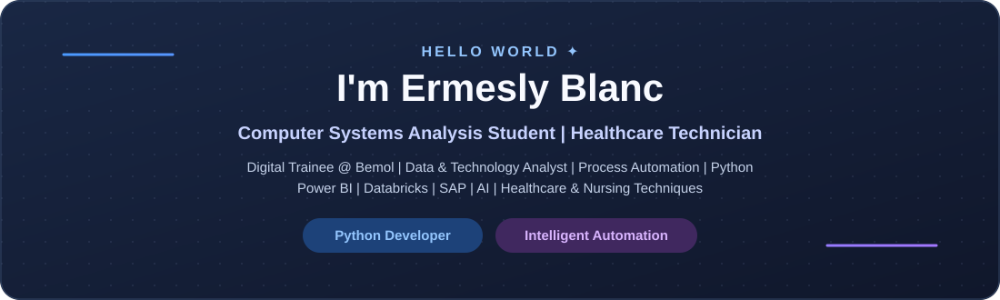
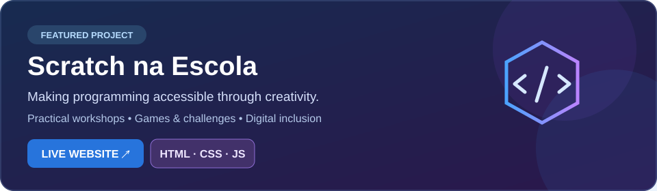

 

  

*Building solutions that turn repetitive work into smarter processes.*

---

## 🌟 Featured Project - Scratch na Escola

 

**Scratch na Escola** is a web-based educational extension project designed to make introductory programming approachable and creative. Its website presents **hands-on workshops, short games and challenges, project methodology, team information and digital inclusion goals**.

**Tech:** HTML · CSS · JavaScript · Scratch education · Vercel deployment

> Visit the [live website](https://projeto-scratch.vercel.app/) to explore the project or check the [GitHub repository](https://github.com/ErmeslyBlanc/projeto_scratch) for its source code.

## 🗂️ Selected Public Projects

These projects are available in my public GitHub repositories.

| Project | Description | Technologies | Links |
| :-- | :-- | :-- | :-- |
| **Scratch na Escola** | Educational extension website about introductory Scratch programming, workshops and digital inclusion | HTML, CSS, JavaScript | [Live website](https://projeto-scratch.vercel.app/) - [Source](https://github.com/ErmeslyBlanc/projeto_scratch) |
| **Java OOP Mini Project** | Classes, encapsulation, inheritance and polymorphism in an academic Java project | Java, OOP | [Source](https://github.com/ErmeslyBlanc/mini-projeto-poo-aulas01-04) |
| **Concurso Escola** | Web application with pages for Home, Concursos and Sobre | React, Vite, JavaScript | [Source](https://github.com/ErmeslyBlanc/concurso-escola) |

## 👨‍💻 About Me

I'm **Ermesly Blanc**, a **Computer Systems Analysis Student | Healthcare Technician**, and a **Digital Trainee at Bemol** in Manaus, Brazil.

My work connects **software development, data analysis and process automation**. I use technology to streamline operations, integrate systems, develop dashboards and help teams make data-informed decisions.

My professional interests include **Python, Power BI, Databricks, SAP, AI and intelligent automation**. I also bring a background in healthcare and nursing techniques, which adds a multidisciplinary perspective to the problems I solve.

<table>
<tr>
<td width="50%" valign="top">

**🔎 What I do**

- Automate workflows using Python, RPA and n8n
- Explore and transform data with SQL and Databricks
- Build business insights with Power BI
- Support systems integration and process improvement

</td>
<td width="50%" valign="top">

**🚀 What drives me**

- Practical applications of AI and LLMs
- Clean, maintainable Python solutions
- Data engineering and analytics
- Continuous learning and digital transformation

</td>
</tr>
</table>

## 🛠️ Tech Stack

**Languages & development**

**Data & business intelligence**

**Automation, platforms & AI**

## 💼 Professional Experience

| Role | Period | Highlights |
|:--|:--|:--|
| **Digital Trainee - Bemol** | Mar 2025 - Present | Python/RPA/n8n automation, data analysis, process improvement and business intelligence |
| **Healthcare Technician Intern - Bemol** | Apr 2024 - Mar 2025 | Occupational health support, clinical screening and process organization |
| **Programming Intern - Bemol** | Apr 2023 - Apr 2024 | Python development, data analysis, automation and BI tools |
| **Technology Apprentice - Bemol Digital** | May 2020 - Mar 2022 | Introduction to technology, programming and digital solutions |
| **Customer Service Apprentice - JL Frios Frigorífico** | Mar 2018 - Aug 2019 | Customer service and operational support |

## 🎓 Education & Learning

| Program | Institution | Period |
|:--|:--|:--|
| **Computer Systems Analysis** (Technology Degree) | UniNorte | Mar 2025 - Dec 2026 (expected) |
| **Healthcare / Nursing Technician** | Giga Instituição Educacional | Jun 2023 - Dec 2024 |

**Selected certifications & learning experiences**

- 🇨🇦 **English Language Study - Certificate of Completion**, ILSC Education Group, Montréal (Aug 2026)
- 🐍 **Python Brasil 2025 - Conference Talks Participation**, Python Brasil (Nov 2025)

[View more professional credentials on LinkedIn](https://www.linkedin.com/in/ermesly-blanc-640a1a170/)

## ✨ Areas of Interest

<table>
<tr>
<td width="50%" valign="top">

### 🤖 Intelligent Automation

Python scripting, RPA, workflow orchestration, system integrations and the use of AI to simplify repetitive tasks.

</td>
<td width="50%" valign="top">

### 📊 Data & Analytics

SQL, Databricks, dashboards, data preparation and turning operational information into actionable insights.

</td>
</tr>
<tr>
<td valign="top">

### 🧠 Applied AI

Exploring language models, AI-assisted validation and practical AI solutions for everyday challenges.

</td>
<td valign="top">

### 💻 Software Engineering

Strengthening Python, APIs, version control and software design while building an evolving development portfolio.

</td>
</tr>
</table>

> 🔒 **Professional confidentiality:** Internal implementations, corporate data and non-public source code are not shared in this profile. My public repositories reflect work appropriate for public release.

## 📈 GitHub Statistics

 

Cards are provided by third-party services and can temporarily fail to load. Private repository activity may not be included.

## 🐍 Animated Contributions

<picture>
  <source media="(prefers-color-scheme: dark)" srcset="./assets/github-snake-dark.svg"/>
  
</picture>

Automatically regenerated with GitHub Actions using your contribution history.

---

### 💜 Let's Connect

Interested in **Python, automation, data or AI**? Find me on [LinkedIn](https://www.linkedin.com/in/ermesly-blanc-640a1a170/) or explore my [public repositories](https://github.com/ErmeslyBlanc?tab=repositories).

**Turning ideas into intelligent solutions through technology, data and automation.**

Profile visits

